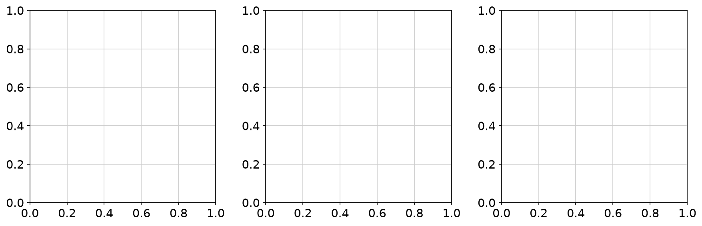
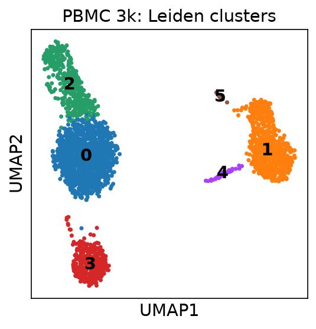
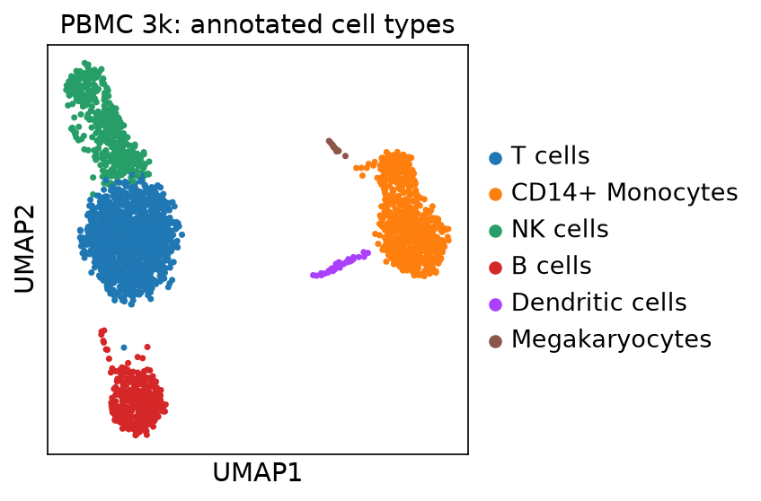
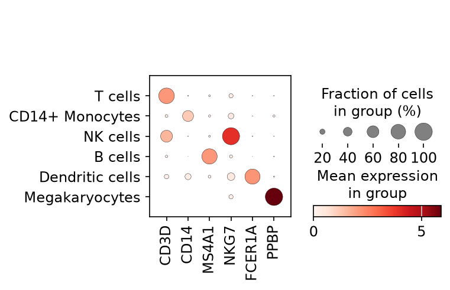
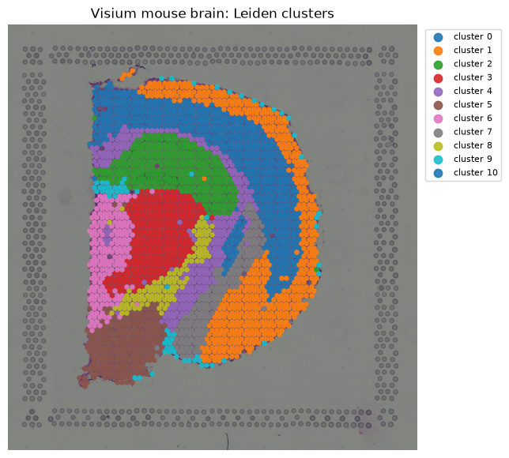
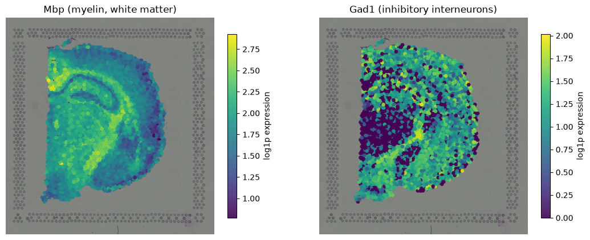

# Single-cell RNA-seq and Visium spatial transcriptomics of human immune tissue

Two-part portfolio project using free public 10x Genomics demo data and free
Python tools: single-cell RNA-seq of human PBMCs with **Scanpy**, and spatial
transcriptomics of mouse brain with **Squidpy**.

## Part 1: scRNA-seq (PBMC 3k, Scanpy)

- Data: 10x PBMC 3k filtered feature-barcode matrix (2700 cells x 32738 genes).
- QC: per-cell gene counts, total counts, mitochondrial percentage.
- Filtering: min 200 genes/cell, min 3 cells/gene, mitochondrial reads < 5%.
  Retained **2643 cells x 13714 genes**.
- Pipeline: total-count normalization (1e4) + log1p, 1844 highly variable
  genes, regression of total counts and MT%, scaling, PCA, kNN graph,
  Leiden clustering (resolution 0.5), UMAP.



- **6 Leiden clusters** found. Marker genes per cluster (Wilcoxon rank-sum)
  were used to annotate cell types with canonical markers:

| Cluster | Cell type | Supporting markers | Cells |
|---|---|---|---|
| 0 | T cells | CD3D | 1182 |
| 1 | CD14+ Monocytes | LYZ, TYROBP, AIF1, LST1, S100A9, CST3 | 636 |
| 2 | NK cells | NKG7, GZMA, CTSW | 427 |
| 3 | B cells | MS4A1, CD79A, CD79B | 349 |
| 4 | Dendritic cells | FCER1A, HLA-DRA, HLA-DPB1, CD74 | 36 |
| 5 | Megakaryocytes | PPBP, PF4 | 13 |





## Part 2: Visium spatial transcriptomics (Squidpy)

- Data: 10x Visium adult mouse brain coronal section, served by
  `squidpy.datasets.visium_hne_adata()` (2688 spots x 18078 genes).
  Note: the original plan was human lymph node, but the squidpy loader
  serves the mouse brain demo, so the swap is stated here and in
  `data/METADATA`.
- Filtering: min 500 counts/spot, min 10 spots/gene. Retained
  **2688 spots x 16957 genes**.
- Pipeline: normalization + log1p, 2000 highly variable genes, PCA,
  neighbors, Leiden clustering (resolution 0.5): **11 spatial clusters**.
  Clusters map cleanly onto anatomy (e.g. a myelin-rich cluster with
  Mbp/Mobp/Mal, neuronal clusters with Camk2a/Slc17a6).



- Spatial gene expression: Mbp (myelin, white-matter tracts) and Gad1
  (inhibitory interneurons) show the expected complementary patterns.



- Spatial autocorrelation (Moran's I) on the 2000 HVGs, top 5:

| Gene | Moran's I | p-value |
|---|---|---|
| Mbp | 0.7883 | 0.0 |
| Slc17a7 | 0.7752 | 0.0 |
| Nrgn | 0.7433 | 0.0 |
| Cck | 0.7274 | 0.0 |
| Itpka | 0.6980 | 0.0 |

## Repository layout

- `data/`: `download.sh`, `METADATA` (dataset names, source URLs, access date)
- `results/`: `qc_metrics.csv`, `cluster_markers.csv`, `annotation.csv`,
  `visium_qc.csv`, `visium_markers.csv`, `moransI_top.csv`
- `figures/`: all PNGs shown above
- `scripts/`: `01_scrna_analysis.py`, `02_spatial_analysis.py` (commented;
  regenerate everything from the repo root)

## Reproduce

```bash
python3 -m venv venv && venv/bin/pip install scanpy squidpy leidenalg
bash data/download.sh
cd single-cell-spatial-omics   # if running from the workdir
venv/bin/python scripts/01_scrna_analysis.py
venv/bin/python scripts/02_spatial_analysis.py
```

## Tool versions

Python 3.12, scanpy 1.12.5, squidpy 1.8.4, leidenalg 0.12.0,
anndata 0.13.4, matplotlib 3.11.2, numpy 2.5.4, pandas 3.1.0.

## Caveats

- Demo data at demo scale; this shows the standard workflow, not a biological study.
- Cell-type labels come from canonical marker genes, not FACS-validated sorting.
- The Visium set is mouse brain (squidpy's `visium_hne_adata`), not human
  lymph node; the swap is documented in `data/METADATA`.
- Spatial maps were rendered with matplotlib over the H&E image from
  squidpy-loaded coordinates (squidpy 1.8.4 `spatial_scatter` is incompatible
  with the installed matplotlib's PatchCollection handling).
